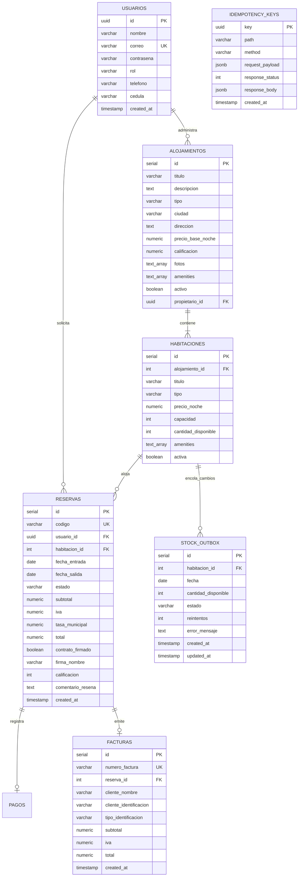
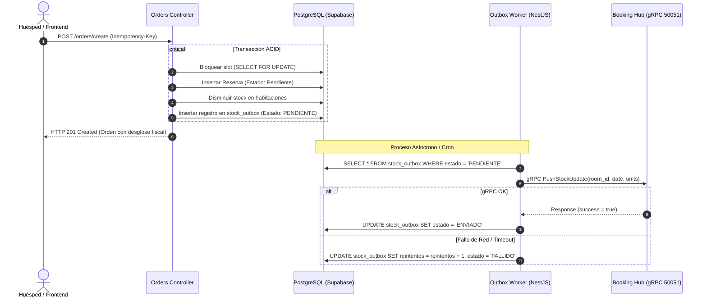
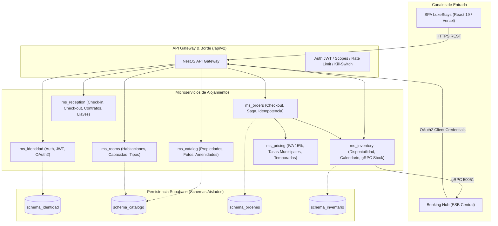

# ARQUITECTURA TÉCNICA · LUXESTAYS (PROYECTO RDA1)
## Dominio de Alojamientos · Integración de Sistemas

---

## 1. Resumen Ejecutivo

**LuxeStays** es el subsistema de alojamiento de alta gama para la plataforma de integración turística del Ecuador (Proyecto RDA1). El sistema provee gestión de catálogo, inventario en tiempo real con sincronización gRPC hacia el **Booking Hub**, pasarela de pagos con emisión de **facturación electrónica SRI** (`001-001-XXXXXXXXX`), contratos digitales de arrendamiento temporal con validación de identidad ecuatoriana (Cédula con Módulo 10 y RUC) y transacciones idempotentes según RFC 7807.

---

## 2. Pila Tecnológica (Tech Stack)

### Backend (Monolito Modular)
- **Framework:** NestJS 10 (TypeScript 5.x)
- **ORM & Persistencia:** TypeORM 0.3.x conectando a PostgreSQL 15 en **Supabase** (`aws-0-ca-central-1.pooler.supabase.com:6543`, SSL obligatorio).
- **Comunicación gRPC:** `@grpc/grpc-js` y `@grpc/proto-loader` (puerto 50051 hacia Booking Hub).
- **Seguridad:** BCrypt (60 caracteres), JWT con clave simétrica $\ge 32$ caracteres, RBAC (`Admin`, `Anfitrión`, `Cliente`).
- **Idempotencia:** RFC 7807 Problem Details con almacenamiento relacional en PostgreSQL (`idempotency_keys`).
- **Despliegue:** Render Web Service (Node.js runtime, port 3000).

### Frontend (SPA Desacoplada)
- **Framework:** React 19 + TypeScript (Vite 8.3)
- **Rutas y Navegación:** React Router 7
- **Estilos:** Vanilla CSS moderno con Design Tokens de Lujo (`#0B132B`, `#1C2541`, `#D4AF37`), tipografía *Outfit* / *Inter* y micro-animaciones con `framer-motion`.
- **Iconografía:** Lucide React
- **Despliegue:** Vercel

---

## 3. Modelo de Datos Relacional (PostgreSQL)



---

## 4. Patrón Transaccional Outbox & Sincronización gRPC

Para garantizar consistencia eventual con el **Booking Hub** sin bloquear la transacción HTTP del huésped, se implementa el **Transactional Outbox Pattern**:



### Contrato Protocol Buffer (`inventory.proto`)
```protobuf
syntax = "proto3";
package inventory;

service InventoryService {
  rpc PushStockUpdate(StockUpdateRequest) returns (StockUpdateResponse);
  rpc GetSlotAvailability(SlotAvailabilityRequest) returns (SlotAvailabilityResponse);
  rpc StreamInventoryChanges(StreamChangesRequest) returns (stream InventoryChangeChunk);
}

message StockUpdateRequest {
  string room_id = 1;
  string date = 2; // YYYY-MM-DD
  int32 available_units = 3;
  string hotel_code = 4;
}

message StockUpdateResponse {
  bool success = 1;
  string message = 2;
  int64 timestamp = 3;
}
```

---

## 5. Transición Arquitectónica hacia Reto 2 (7 Microservicios)

En la fase siguiente (Reto 2), el actual monolito modular se dividirá horizontalmente en 7 microservicios desacoplados con API Gateway, CloudEvents y esquemas separados en PostgreSQL:



### Tabla de Responsabilidades de los 7 Microservicios

| Microservicio | Responsabilidad Principal | Protocolo Externo | Base de Datos / Esquema |
| :--- | :--- | :---: | :--- |
| **`ms_identidad`** | Gestión de usuarios, autenticación, refresh tokens y roles RBAC. | REST / JWT | `schema_identidad` |
| **`ms_catalog`** | Catálogo de hoteles, villas, fotos en alta resolución y calificaciones. | REST / Cache | `schema_catalogo` |
| **`ms_rooms`** | Gestión estructural de habitaciones, tipos y capacidades. | REST | `schema_catalogo` |
| **`ms_inventory`** | Control de stock diario, `stock_outbox` y cliente gRPC hacia Booking. | gRPC / REST | `schema_inventario` |
| **`ms_orders`** | Orquestación Saga de compra, idempotencia RFC 7807 y facturación SRI. | REST | `schema_ordenes` |
| **`ms_pricing`** | Motor de cálculo de IVA (15%), tasas cantonales y factores estacionales. | gRPC interno | Sin estado |
| **`ms_reception`** | Check-in (14:00), Check-out (11:00), firma legal y auditoría de llaves. | REST | `schema_ordenes` |

---

## 6. Políticas de Seguridad y Cumplimiento Normativo

1. **Protección de Datos (LOPDP Ecuador):** No se almacenan números completos de tarjeta de crédito (únicamente token o últimos 4 dígitos). Las contraseñas se hashean con BCrypt (salt rounds 10).
2. **Validación Cédula / RUC:** Algoritmo de Módulo 10 estricto para cédulas de 10 dígitos y RUCs terminados en 001.
3. **Facturación Electrónica SRI:** Secuencial estandarizado `001-001-XXXXXXXXX` proveniente de la secuencia atómica `seq_numero_factura`.
4. **Política 24h de Cancelación:** El sistema evalúa `Date.now()` contra la hora legal de Check-in (`fechaEntradaT14:00:00-05:00`). Cancelaciones dentro de la ventana de 24h son rechazadas con HTTP 409 `CANCELACION_NO_PERMITIDA`.
